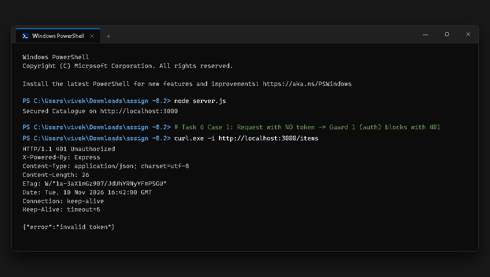
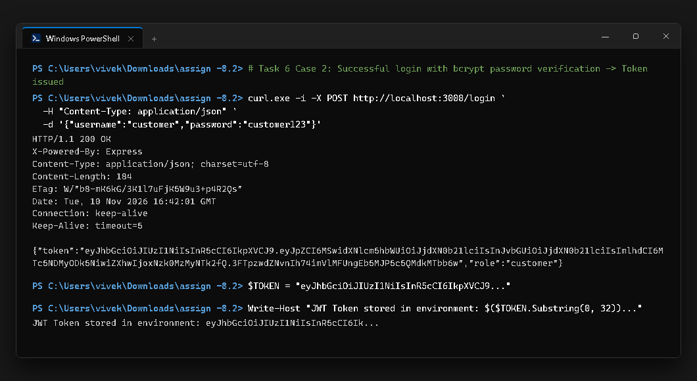
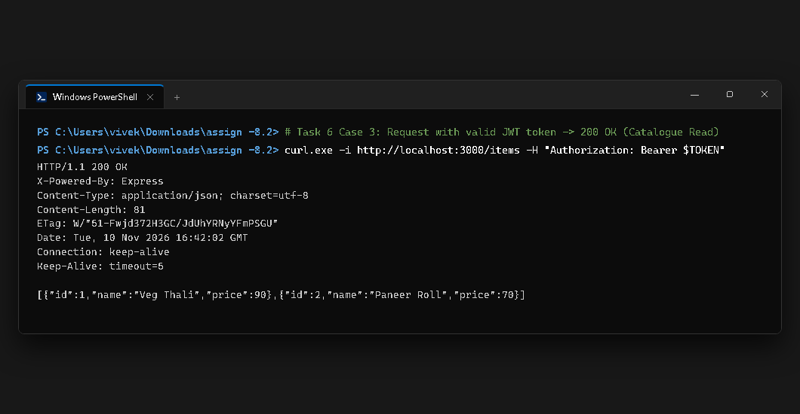
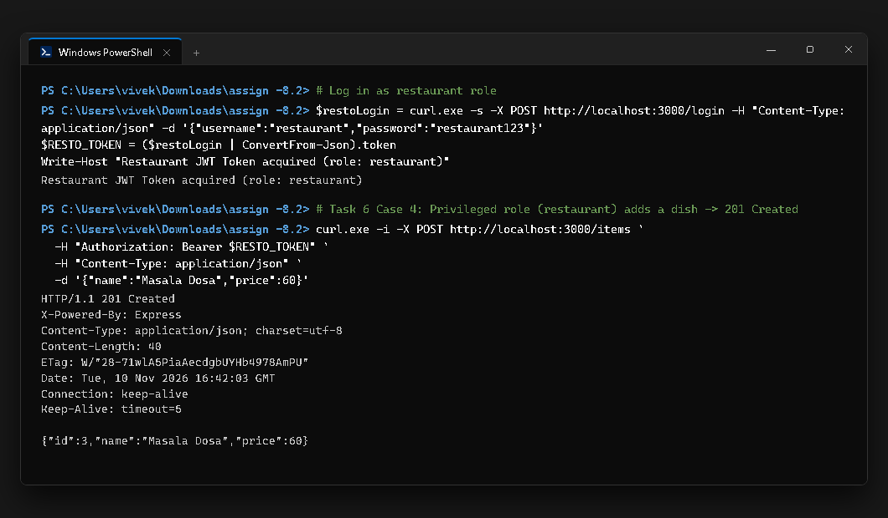
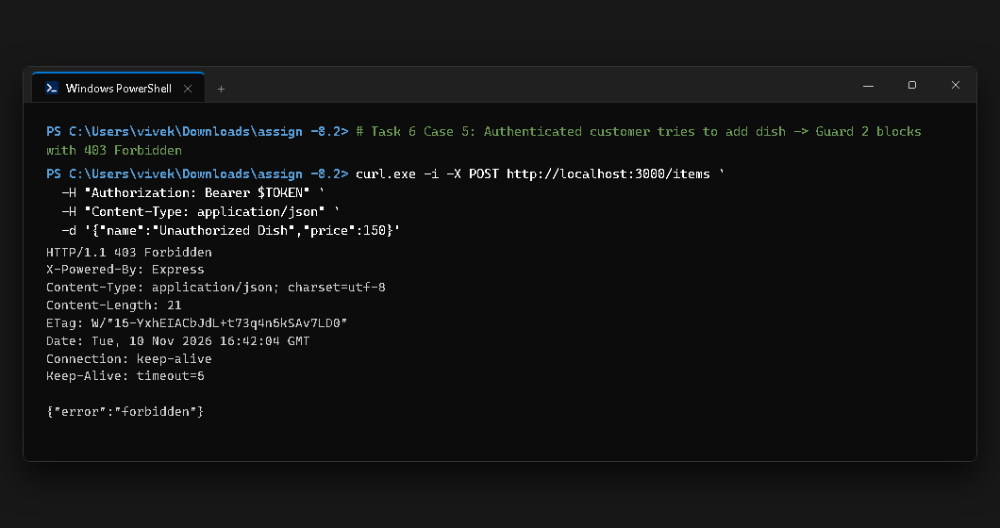

# CS543 Web Services &mdash; Assignment 09 of 12
## Securing the API: JWT Authentication & Role-Based Access Control

### Team Members
| Name | Roll Number |
| :--- | :--- |
| **Dipesh Mishra** | 20251651036 |
| **Suraj Ku. Saw** | 20251651092 |
| **Sandeep Parmar** | 20251651081 |
| **Vivek Kumar** | 20251651104 |

---

## 🚀 Quick Start (One-Line Execution)

```bash
npm install && npm start
```
*The secured service will start at **[http://localhost:3000](http://localhost:3000)**.*

### Run Automated Live Demonstration Suite
To run all 5 demonstration test cases with live status validation:
```bash
npm test
```

---

## 📋 Project Structure

```text
Assignment_09/
├── .env                  # Secret configuration (JWT_SECRET, git-ignored)
├── .env.example          # Template configuration committed to git
├── .gitignore            # Excludes node_modules and .env
├── package.json          # Project manifest listing express, jsonwebtoken, bcryptjs, dotenv
├── package-lock.json     # Locked dependency tree
├── server.js             # Secured REST API with auth & requireRole middleware
├── test-demo.js          # Automated demonstration runner for Task 6
├── public/
│   ├── index.html        # Front-end UI with Login, JWT handling & Role checks
│   └── style.css         # UI stylesheet
├── screenshots/          # System-generated screenshots of the 5 demo cases
│   ├── 01_no_token_401.png
│   ├── 02_login_success_token.png
│   ├── 03_authenticated_read_200.png
│   ├── 04_privileged_write_201.png
│   └── 05_customer_forbidden_403.png
└── README.md             # Assignment documentation & questions answered
```

---

## 📝 Answers to Assignment Questions

### 1. Which route(s) require only authentication, and which also require a role? Give the method + path and the role allowed for each.

| HTTP Method | Route Path | Protection Level | Middleware Guards | Allowed Roles | Description |
| :--- | :--- | :--- | :--- | :--- | :--- |
| `POST` | `/login` | **Public** | None | Public (Any) | Accepts credentials, checks bcrypt hash, returns JWT token. |
| `GET` | `/` | **Public** | Static middleware | Public (Any) | Serves the front-end user interface. |
| `GET` | `/items` | **Authentication Only** | `auth` | `customer`, `restaurant`, `admin` | Lists all menu dishes in catalogue. |
| `GET` | `/items/:id` | **Authentication Only** | `auth` | `customer`, `restaurant`, `admin` | Fetches a single dish by ID or returns 404. |
| `POST` | `/items` | **Authentication + Role** | `auth`, `requireRole('restaurant', 'admin')` | `restaurant`, `admin` only | Creates a new dish record in catalogue (201 Created). |
| `DELETE` | `/items/:id` | **Authentication + Role** | `auth`, `requireRole('restaurant', 'admin')` | `restaurant`, `admin` only | Deletes a dish record from catalogue (204 No Content). |

---

### 2. Show one 401 and one 403 from your demo. In one line each, say why the server returned that code (not the other).

#### Sample 401 Unauthorized Output:
```http
GET /items HTTP/1.1
Host: localhost:3000
[No Authorization Header]

HTTP/1.1 401 Unauthorized
Content-Type: application/json; charset=utf-8

{
  "error": "invalid token"
}
```
> **Reason for 401:** The server returned **401 Unauthorized** because the client failed **authentication** (Guard 1: `auth` middleware found no valid JWT token, so identity was unknown).

---

#### Sample 403 Forbidden Output:
```http
POST /items HTTP/1.1
Host: localhost:3000
Authorization: Bearer <valid_token_for_customer>
Content-Type: application/json

{"name": "Unauthorized Dish", "price": 150}

HTTP/1.1 403 Forbidden
Content-Type: application/json; charset=utf-8

{
  "error": "forbidden"
}
```
> **Reason for 403:** The server returned **403 Forbidden** because the client was successfully **authenticated** (the server verified the token and knows identity is `customer`), but failed **authorization** (Guard 2: `requireRole` denied access because role `customer` lacks permission to modify catalogue data).

---

### 3. What is inside your JWT payload? Why is it safe to trust the role claim on the server, and why must the secret stay out of your code?

#### 1. What is inside your JWT payload?
Our decoded JWT payload contains the user's primary identity attributes, assigned role, and standard cryptographic timestamp claims:
```json
{
  "id": 1,
  "username": "customer",
  "role": "customer",
  "iat": 1794324861,
  "exp": 1794328461
}
```
- `id`: Unique identifier of the user account in the system.
- `username`: Account login name (`customer` or `restaurant`).
- `role`: Role claim (`customer` or `restaurant`) used by `requireRole(...)`.
- `iat`: *Issued At* unix timestamp.
- `exp`: *Expiration* unix timestamp (1 hour after issuance via `expiresIn: '1h'`).

#### 2. Why is it safe to trust the role claim on the server?
The role claim is safe to trust because the JWT is cryptographically signed using the HMAC-SHA256 (`HS256`) algorithm with a private secret key known exclusively to the server. If an attacker or client modifies any part of the header or payload (for example, attempting to escalate `"role": "customer"` to `"role": "restaurant"` or `"role": "admin"`), the computed signature will no longer match the token's signature header. When the server executes `jwt.verify(token, SECRET)`, the cryptographic integrity verification immediately fails, the token is rejected, and an HTTP 401 error is returned.

#### 3. Why must the secret stay out of your code?
The secret (`JWT_SECRET`) is the cryptographic root of trust for the entire system:
1. Anyone in possession of `JWT_SECRET` can forge valid, legitimate-looking JWTs carrying arbitrary identities and administrator privileges.
2. Hardcoding secrets in source files causes them to be permanently recorded in git commit histories and exposed if pushed to shared or public GitHub repositories.
3. Keeping the secret in a git-ignored `.env` file loaded via `process.env.JWT_SECRET` ensures separation of code and configuration (as prescribed by Twelve-Factor App methodology) and allows rotating keys across development, staging, and production environments without changing application code.

---

## 📸 Demonstration Screenshots (Task 6 Cases)

### Case 1: Request with No Token &rarr; 401 Unauthorized


### Case 2: Successful Login &rarr; 200 OK + JWT Token Issued


### Case 3: Request with Valid Token &rarr; 200 OK (Catalogue Read)


### Case 4: Privileged Role (`restaurant`) on Write Route &rarr; 201 Created


### Case 5: Non-Privileged Role (`customer`) on Write Route &rarr; 403 Forbidden


---
