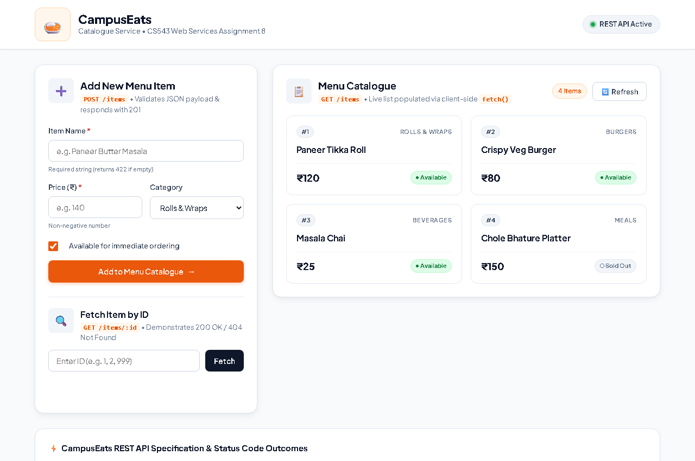
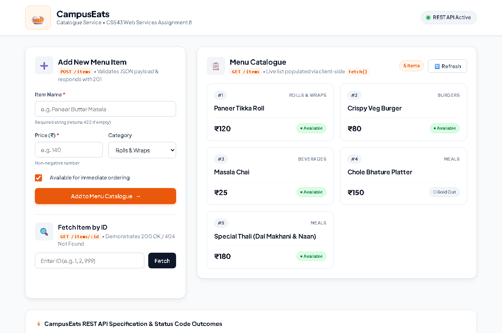

# CS543 Web Services — Assignment 8
## Build one CampusEats service as a REST API

### Team Members
| Name | Roll Number |
| :--- | :--- |
| **Dipesh Mishra** | 20251651036 |
| **Suraj Ku. Saw** | 20251651092 |
| **Sandeep Parmar** | 20251651081 |
| **Vivek Kumar** | 20251651104 |

---

## 🚀 One-Line Run Command
```bash
npm install && npm start
```
*The service will start at [http://localhost:3000](http://localhost:3000)*.

---

## 📋 Assignment Questions & Answers

### 1. Which CampusEats service did you pick, and what are its routes (method + path)?

We selected the **CampusEats Menu / Catalogue Service** (`/items`), which models food items offered across campus dining stalls. 

The exposed REST routes are:
| HTTP Method | Route Path | Purpose / Description |
| :--- | :--- | :--- |
| `GET` | `/items` | **List** — Returns an array of all menu items in the catalogue. |
| `GET` | `/items/:id` | **Fetch-One** — Returns a single item matching the provided `id`. |
| `POST` | `/items` | **Create** — Adds a new item to the catalogue with an auto-incremented `id`. |

---

### 2. Which status codes did you return, and for which outcomes (200 / 201 / 404 / 422)?

We mapped standard HTTP status codes strictly according to REST principles:

* **`200 OK`**:
  * Returned on successful **`GET /items`** to deliver the list of menu items.
  * Returned on successful **`GET /items/:id`** when the requested item exists.
* **`201 Created`**:
  * Returned on successful **`POST /items`** after validating the request payload, persisting the new item record, and returning the newly created record.
* **`404 Not Found`**:
  * Returned on **`GET /items/:id`** when no menu item exists with the specified `id` parameter.
* **`422 Unprocessable Entity`**:
  * Returned on **`POST /items`** when input validation fails — specifically if the required `name` field is missing/empty, or if `price` is missing or negative.

---

### 3. Where did you use `req.params` and where `req.body`? Why does POST need `express.json()`?

* **`req.params`**:
  * Used in the **`GET /items/:id`** handler:
    ```javascript
    const targetId = parseInt(req.params.id, 10);
    ```
    Here, `:id` is a URL route parameter. Express extracts URL placeholder segments and binds them to the `req.params` dictionary.

* **`req.body`**:
  * Used in the **`POST /items`** handler:
    ```javascript
    const { name, price, category, available } = req.body;
    ```
    Here, the client transmits the new item data inside the HTTP request body as serialized JSON.

* **Why does POST need `express.json()`?**
  * By default, Node.js HTTP servers receive request bodies as raw binary/stream data chunks (`ReadableStream`). Express does not automatically parse request body streams.
  * `express.json()` is built-in middleware (based on `body-parser`). When an incoming request has the `Content-Type: application/json` header, this middleware reads the binary data stream, parses the JSON string into a native JavaScript object, and attaches it to `req.body`.
  * **Without `app.use(express.json())`, `req.body` is `undefined`**, which will cause property destructuring or access to throw a runtime error (`TypeError: Cannot destructure property 'name' of req.body as it is undefined`).

---

## 🖼️ Live Demonstration & Screenshots

### Demonstration Video
- **Google Drive Video Link:** `[Add your video link here]`

### Demonstration Screenshots
The application was executed locally with seed records and demonstrated live by adding a new item through the UI.

#### 1. Before POST (Initial Catalogue State)
Initial seed records loaded via `GET /items`:


#### 2. After POST (Record Added Live)
New record (`Paneer Butter Masala`, ₹160) submitted via `POST /items` with HTTP 201 response and instant catalogue refresh:


---

## 🛠️ Project Structure
```text
Assignment_8/
├── server.js              # Express REST API with working routes (GET, GET :id, POST)
├── package.json           # Project manifest listing express dependency
├── public/
│   ├── index.html         # Front-end UI (lists items, POST form, lookup)
│   ├── style.css          # Styling for CampusEats responsive UI
│   └── app.js             # Client-side fetch() and DOM logic
├── screenshots/
│   ├── before-post.png    # Live screenshot before adding record
│   └── after-post.png     # Live screenshot after adding record
└── README.md              # Project documentation, answers, and team info
```
